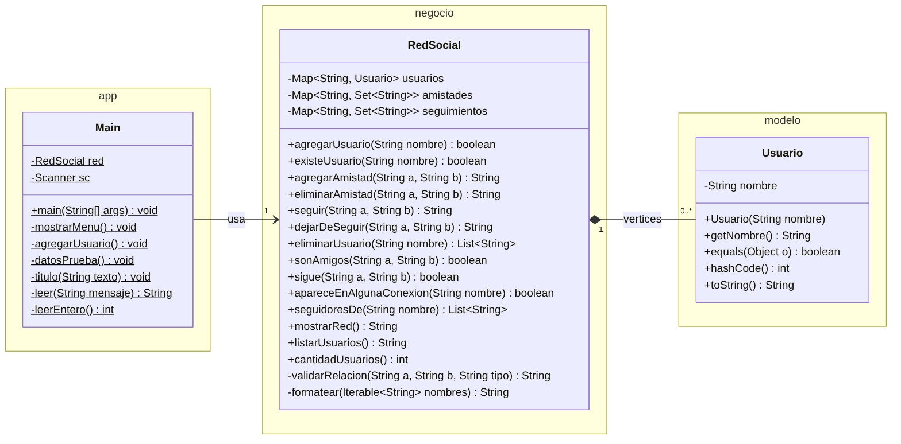

# Red Social mediante Grafos Dinámicos

Simulación de una red social como un grafo dinámico en Java. Los usuarios son los vértices. Las relaciones son de dos tipos de arista:

- **Amistad**: arista no dirigida, funciona en ambos sentidos.
- **Seguimiento**: arista dirigida, funciona en un solo sentido.

## Reglas implementadas

| Regla | Dónde se cumple |
|---|---|
| No se permiten amistades de una persona consigo misma | `RedSocial.agregarAmistad` (validación `a.equals(b)`) |
| Una amistad funciona en ambos sentidos | `agregarAmistad` y `eliminarAmistad` actualizan los dos conjuntos |
| Un seguimiento funciona en una sola dirección | `seguir` guarda solo en el conjunto de quien sigue |
| Al eliminar un usuario desaparecen todas sus conexiones | `eliminarUsuario` limpia amistades, seguidos y seguidores |

## Representación

Lista de adyacencia con dos mapas:

- `Map<String, Set<String>> amistades`
- `Map<String, Set<String>> seguimientos`

Se usa `Set` para que una misma relación no se repita.

## Estructura

```
Red-Social/
├── src/
│   ├── modelo/Usuario.java
│   ├── negocio/RedSocial.java
│   └── app/Main.java
├── capturas/
├── diagramas/
└── README.md
```

## Diagrama de clases



- `Main` usa una `RedSocial` (asociación).
- `RedSocial` contiene a los `Usuario` (composición): si se elimina un usuario de la red, deja de existir junto con sus conexiones.

## Ejecución

```
javac -d out src/modelo/*.java src/negocio/*.java src/app/*.java
java -cp out app.Main
```

La opción **8. Cargar datos de prueba** simula la actividad completa:

1. Creación de Ana, Beto, Carlos y Dani.
2. Amistades Ana ↔ Beto, Ana ↔ Carlos, Carlos ↔ Dani y seguimientos Beto → Carlos, Dani → Ana.
3. Modificaciones: se agrega Beto ↔ Dani, se elimina Beto → Carlos, se agrega Carlos → Beto.
4. Eliminación de Carlos y todas sus conexiones.
5. Red final y verificación de las cuatro reglas.

## Red final

- Ana: amiga de Beto
- Beto: amigo de Ana y de Dani
- Dani: amigo de Beto, sigue a Ana

## Capturas


## Autor

Juan Carlos Chico Yunda, Estructura de Datos, Nivel III, UTA FISEI.
